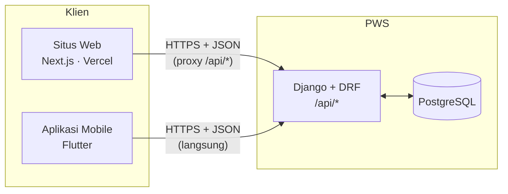

# HABISIN Mobile

> **Save Food, Cut Waste, Feed Communities.**

Aplikasi mobile (Flutter) dari **HABISIN**, versi mobile dari [proyek tengah semester HABISIN](https://github.com/HabisinID/habisin). Aplikasi ini terhubung ke backend Django yang sama melalui web service **Django REST Framework (DRF)**.

| Tautan | URL |
| --- | --- |
| Repositori web (PTS) | https://github.com/HabisinID/habisin |
| Backend Django (PWS) | https://rozan-laudzai-habisin-backend.pws.cs.ui.ac.id |
| Situs web | https://habisin-id.vercel.app |
| Desain Figma | `[TODO: tautan Figma]` |
| Unduh APK | `[TODO: tautan APK — diisi setelah Checkpoint 1]` |

---

## Daftar Isi

1. [Anggota Kelompok](#anggota-kelompok)
2. [Deskripsi Aplikasi](#deskripsi-aplikasi)
3. [Modul dan Pembagian Kerja](#modul-dan-pembagian-kerja)
4. [Peran Pengguna](#peran-pengguna)
5. [Alur Integrasi Data Mobile ↔ Web](#alur-integrasi-data-mobile--web)
6. [Daftar Endpoint DRF per Modul](#daftar-endpoint-drf-per-modul)
7. [Halaman dan Navigasi](#halaman-dan-navigasi)
8. [Menjalankan Aplikasi](#menjalankan-aplikasi)
9. [Alur Kerja Git](#alur-kerja-git)
10. [AI Disclosure](#ai-disclosure)

---

## Anggota Kelompok

**Kelompok 10 — PBP B**

| Nama | NPM | Tanggung Jawab |
| --- | --- | --- |
| Rozan Laudzai | 2506547544 | Identity & Partner Location |
| Christiano Hosea | 2506615280 | Surplus Catalog, Map Explorer & Search |
| Damica Adreeza Ramadhan | 2506625193 | Admin Moderation |
| Violin Monica | 2506551794 | Booking & Digital Ticket |
| Raihan Daffa Aprilianda | 2506620021 | Reputation & Partner Dashboard |

---

## Deskripsi Aplikasi

**HABISIN** mempertemukan gerai makanan yang punya makanan berlebih (*surplus*) dengan masyarakat di sekitarnya. Pembeli bisa menemukan makanan surplus lewat peta dan katalog. Mereka lalu memesannya dengan harga diskon atau mengklaimnya gratis sebagai donasi, dan mengambilnya di toko sebelum batas waktu operasional berakhir dengan menunjukkan tiket digital.

Menurut [KLH 2025](https://sampahnasional.kemenlh.go.id/portal-indikatif/data/komposisi-sampah), sisa makanan menyumbang **40,16%** komposisi sampah di Indonesia. HABISIN membantu pelaku usaha menekan kerugian, meringankan pengeluaran masyarakat, dan menjadikan penanganan *food waste* aksi pengurangan emisi yang terukur.

Fungsi utama aplikasi mobile:

- Menjelajah peta dan katalog makanan surplus, lengkap dengan pencarian dan filter.
- Memesan makanan, menjalankan simulasi pembayaran (*mock payment*), dan menerima tiket digital berkode klaim + QR.
- Mengelola toko, listing makanan, dan verifikasi kode klaim di kasir (Mitra).
- Memberi ulasan dan mengajukan komplain atas pesanan.
- Memantau statistik penjualan dan porsi terselamatkan (Mitra).
- Memoderasi mitra, listing, dan log moderasi (Admin).

**Domain:** Food Waste Management, Environmental Sustainability
**Sumber data:** basis data backend HABISIN (PostgreSQL di PWS), diisi oleh pengguna dan *seed* demo (`seed_demo`, `seed_depok_stores`). Nama toko dan koordinat pada data demo bersifat ilustratif.

---

## Modul dan Pembagian Kerja

> **Catatan:** Pada proyek web, Modul 5 dikerjakan oleh Damica Adreeza Ramadhan. Untuk aplikasi mobile, **Modul 5 dikerjakan oleh Christiano Hosea**. Modul 10 mencakup bagian yang sudah tersedia di backend web, yaitu statistik penjualan mitra. Kalkulator dampak lingkungan publik tidak diimplementasikan.

| No | Modul | Penanggung Jawab | Ringkasan Fitur Mobile |
| --- | --- | --- | --- |
| 1 | Autentikasi & Manajemen Pengguna | Rozan Laudzai | Registrasi (cek ketersediaan username), login, logout, profil, edit profil, ganti password, hapus akun. |
| 2 | Onboarding Mitra & Geocoding Toko | Rozan Laudzai | Daftar toko, geocoding alamat (Nominatim), konfirmasi pin di peta, edit, tutup, dan hapus toko. |
| 3 | Manajemen Produk Makanan Surplus | Christiano Hosea | CRUD listing mitra: buat, lihat inventaris, edit, ubah stok, tandai habis, nonaktifkan, hapus. |
| 4 | Peta Sebaran Makanan Interaktif | Christiano Hosea | Peta marker toko, lokasi GPS pengguna, jarak relatif, *popup* toko, halaman profil toko. |
| 5 | Pencarian Katalog & Filter Makanan | **Christiano Hosea** | Pencarian nama makanan/toko, filter kategori, rentang harga, "Hanya Donasi Gratis", daftar kartu produk. |
| 6 | Panel Kontrol & Moderasi Admin | Damica Adreeza Ramadhan | Persetujuan mitra, *take-down*/*restore* listing, CRUD *moderation log*. |
| 7 | Alur Pemesanan & Mock Payment | Violin Monica | Buat, edit, bayar (simulasi), batalkan, dan hapus pesanan dari riwayat. |
| 8 | Tiket Digital & Verifikasi Kode Kasir | Violin Monica | Tiket dengan kode klaim 5 karakter + QR; verifikasi kode oleh mitra dan *undo* 60 detik. |
| 9 | Rating Toko & Sistem Komplain | Raihan Daffa Aprilianda | CRUD ulasan sendiri, rating toko, komplain pesanan, peninjauan komplain oleh admin. |
| 10 | Dasbor Statistik Mitra | Raihan Daffa Aprilianda | Porsi berbayar dan donasi yang sudah diambil, nilai transaksi simulasi, grafik penjualan 7 hari. |

### Matriks CRUD per Anggota

| Anggota | Entitas | Create | Read | Update | Delete |
| --- | --- | --- | --- | --- | --- |
| Rozan Laudzai | Akun Pengguna, Toko Mitra | Registrasi, daftar toko | Profil, profil toko | Edit profil/password, edit toko | Hapus akun, hapus/tutup toko |
| Christiano Hosea | Listing Makanan | Buat listing | Inventaris, peta, katalog & pencarian | Edit listing, stok, nonaktifkan | Hapus listing |
| Damica Adreeza Ramadhan | Moderation Log | Catat tindakan moderasi | Riwayat & filter log | Edit catatan/alasan | Hapus entri log |
| Violin Monica | Reservasi/Pesanan | Buat pesanan | Ringkasan & tiket | Edit pesanan, bayar, verifikasi kasir | Batal & hapus dari riwayat |
| Raihan Daffa Aprilianda | Ulasan & Komplain | Tulis ulasan/komplain | Rating toko, ulasan & komplain sendiri | Edit ulasan | Hapus ulasan |

---

## Peran Pengguna

| Peran | Deskripsi | Hak Akses Utama |
| --- | --- | --- |
| **Tamu** | Pengguna yang belum login. | Melihat katalog, peta, dan profil toko; registrasi dan login. |
| **Pembeli** | Pengguna umum yang mencari makanan surplus di sekitarnya. | Mencari/memfilter katalog, memesan, *mock payment*, tiket digital, ulasan, dan komplain. |
| **Mitra** | Pemilik/pengelola gerai makanan. | Mengelola toko dan listing, verifikasi kode klaim di kasir, melihat pesanan masuk dan statistik penjualan. |
| **Admin** | Pengelola platform (`is_staff`). | Menyetujui/menolak mitra, *take-down* listing, meninjau komplain, mengelola *moderation log*. |

Akun Admin tidak dibuat lewat registrasi publik. Akun ini dibuat melalui `python manage.py createsuperuser` di backend.

---

## Alur Integrasi Data Mobile ↔ Web

Aplikasi mobile **tidak memiliki database sendiri**. Situs web (Next.js di Vercel) dan aplikasi Flutter membaca serta menulis ke **backend Django yang sama di PWS**, sehingga data selalu sinkron: listing yang dibuat mitra di web langsung muncul di aplikasi, dan sebaliknya.



### Langkah Alur Data

1. **Model → Serializer.** Data disimpan sebagai model Django (`Listing`, `StoreProfile`, `Reservation`, `Review`, `Complaint`, `ModerationLog`, dst.), lalu diubah menjadi JSON oleh *serializer* DRF.
2. **Endpoint DRF.** Semua endpoint berada di bawah prefiks `/api/` dan mengembalikan JSON. Error memakai format seragam lewat *custom exception handler* (`main.exceptions.exception_handler`), misalnya `{"detail": "..."}`.
3. **Autentikasi sesi + CSRF.** Backend memakai `CsrfSessionAuthentication`, yaitu autentikasi sesi Django dengan CSRF yang **selalu diwajibkan pada request yang mengubah data, termasuk login dan registrasi**. Karena itu, aplikasi Flutter:
   - memanggil `GET /api/auth/csrf` untuk mendapatkan cookie `csrftoken`;
   - mengirim `POST /api/auth/login` dengan header `X-CSRFToken` dan `Referer: <BASE_URL>/`, lalu menyimpan cookie `sessionid` dari respons;
   - menyertakan cookie `sessionid` dan `csrftoken`, header `X-CSRFToken`, serta `Referer` pada setiap request berikutnya (dikelola satu *HTTP client* bersama, misalnya `pbp_django_auth` `CookieRequest` atau `http` + *cookie jar*).
4. **Model Dart.** Respons JSON di-*parse* menjadi kelas model Dart (`fromJson`/`toJson`) di lapisan data, lalu disajikan ke UI melalui *state management* (Provider) dengan status *loading*, *success*, dan *error*.
5. **Otorisasi di server.** Peran (pembeli/mitra/admin) dan kepemilikan data diperiksa di backend. Aplikasi hanya menyembunyikan menu sesuai peran dari `GET /api/auth/me`; keamanan tetap ditegakkan oleh server (respons `401`/`403`).

### Contoh: Pembeli memesan makanan

```text
Flutter                               Django DRF (PWS)
  │ GET  /api/listings ───────────────▶ ListingSerializer → JSON daftar listing
  │ GET  /api/listings/12/reservation-policy ▶ batas porsi & aturan donasi
  │ POST /api/reservations {listing, quantity, note} ▶ stok ditahan, status "pending"
  │ POST /api/reservations/34/pay ────▶ status "paid" + kode klaim 5 karakter
  │ GET  /api/reservations/34 ────────▶ tiket (kode + QR dirender di Flutter)
  ▼
Mitra memasukkan kode → POST /api/partner/verify/check → POST /api/partner/verify/34/pickup
```

---

## Daftar Endpoint DRF per Modul

Base URL: `https://rozan-laudzai-habisin-backend.pws.cs.ui.ac.id/api`

Endpoint ini sudah ada di backend web. Deployment PWS sudah diperiksa pada 16 November 2026: endpoint publik mengembalikan `200`, sedangkan endpoint terproteksi mengembalikan `403` tanpa sesi (sesuai harapan).

**Keterangan status:** ✅ siap dipakai (JSON) · ⚠️ perlu penyesuaian untuk mobile

### Modul 1 — Autentikasi & Manajemen Pengguna (Rozan)

| Metode | Endpoint | Fungsi | Status |
| --- | --- | --- | --- |
| GET | `/auth/csrf` | Mengambil cookie CSRF | ✅ |
| POST | `/auth/register` | Registrasi pembeli/mitra | ✅ |
| POST | `/auth/login` | Login (membuat sesi) | ✅ |
| POST | `/auth/logout` | Logout | ✅ |
| GET | `/auth/username?username=` | Cek ketersediaan username | ✅ |
| GET, PATCH, DELETE | `/auth/me` | Lihat, edit profil, hapus akun | ✅ |
| POST | `/auth/password` | Ganti password | ✅ |

### Modul 2 — Onboarding Mitra & Geocoding Toko (Rozan)

| Metode | Endpoint | Fungsi | Status |
| --- | --- | --- | --- |
| POST | `/partner/geocode` | Alamat → koordinat (Nominatim) | ✅ |
| GET, POST | `/partner/stores` | Daftar toko milik mitra, daftarkan toko | ✅ |
| GET, PATCH, DELETE | `/partner/stores/<id>` | Detail, edit, hapus toko | ✅ |
| POST | `/partner/stores/<id>/close` | Tutup toko sementara | ✅ |
| GET, POST, PATCH, DELETE | `/partner/store` | Toko utama mitra (kompatibilitas) | ✅ |

### Modul 3 — Manajemen Produk Makanan Surplus (Christiano)

| Metode | Endpoint | Fungsi | Status |
| --- | --- | --- | --- |
| GET, POST | `/partner/listings` | Inventaris mitra, buat listing (JSON atau multipart foto) | ✅ |
| GET, PATCH, DELETE | `/partner/listings/<id>` | Detail, edit/nonaktifkan, hapus listing | ✅ |
| POST | `/partner/listings/<id>/sold-out` | Tandai habis | ✅ |
| POST | `/partner/listings/<id>/undo-sold-out` | Batalkan tanda habis | ✅ |

### Modul 4 — Peta Sebaran Makanan (Christiano)

| Metode | Endpoint | Fungsi | Status |
| --- | --- | --- | --- |
| GET | `/listings` | Listing aktif beserta koordinat toko (untuk marker) | ✅ |
| GET | `/stores/<id>` | Profil publik toko | ✅ |
| GET | `/stores/<id>/listings` | Listing aktif milik toko | ✅ |

### Modul 5 — Pencarian Katalog & Filter (Christiano)

| Metode | Endpoint | Fungsi | Status |
| --- | --- | --- | --- |
| GET | `/listings` | Sumber data katalog | ⚠️ |

> Pada web, pencarian dan filter (kata kunci, kategori, rentang harga, donasi gratis) dijalankan di sisi klien atas data `/listings`. Mobile memakai pendekatan yang sama (filter lokal + *debounce* pada input pencarian). Jika jumlah data bertambah, tambahkan *query parameter* (`q`, `category`, `min_price`, `max_price`, `free`) di endpoint ini.

### Modul 6 — Panel Kontrol & Moderasi Admin (Damica)

| Metode | Endpoint | Fungsi | Status |
| --- | --- | --- | --- |
| GET | `/admin/summary` | Ringkasan panel admin | ✅ |
| GET | `/admin/partner-approvals` | Daftar pengajuan mitra | ✅ |
| GET | `/admin/partner-approvals/<id>` | Detail pengajuan | ✅ |
| POST | `/admin/partner-approvals/<id>/approve` | Setujui mitra | ✅ |
| POST | `/admin/partner-approvals/<id>/reject` | Tolak mitra | ✅ |
| GET | `/admin/listings/` | Daftar listing publik | ✅ |
| POST | `/admin/listings/<id>/take-down/` | *Take-down* listing | ✅ |
| POST | `/admin/listings/<id>/restore/` | Pulihkan listing | ✅ |
| GET, POST | `/admin/moderation-logs/` | Lihat (filter `action_type`) & buat log | ✅ |
| GET, PUT, PATCH, DELETE | `/admin/moderation-logs/<id>/` | Detail, edit alasan, hapus log | ✅ |

### Modul 7 — Alur Pemesanan & Mock Payment (Violin)

| Metode | Endpoint | Fungsi | Status |
| --- | --- | --- | --- |
| GET | `/listings/<id>/reservation-policy` | Aturan pemesanan untuk pembeli | ✅ |
| GET, POST | `/reservations` | Riwayat pesanan, buat pesanan | ✅ |
| GET, PATCH, DELETE | `/reservations/<id>` | Detail, edit porsi/catatan, hapus dari riwayat | ✅ |
| POST | `/reservations/<id>/pay` | Simulasi pembayaran berhasil | ✅ |
| POST | `/reservations/<id>/cancel` | Batalkan pesanan (stok kembali) | ✅ |
| GET | `/partner/orders` | Pesanan masuk untuk mitra | ✅ |
| POST | `/partner/reservations/<id>/cancel` | Mitra membatalkan pesanan | ✅ |

### Modul 8 — Tiket Digital & Verifikasi Kasir (Violin)

| Metode | Endpoint | Fungsi | Status |
| --- | --- | --- | --- |
| GET | `/reservations/<id>` | Data tiket (kode klaim, batas ambil) | ✅ |
| POST | `/partner/verify/check` | Cek kode klaim | ✅ |
| POST | `/partner/verify/<id>/pickup` | Tandai sudah diambil | ✅ |
| POST | `/partner/verify/<id>/undo` | Urungkan dalam 60 detik | ✅ |
| GET | `/partner/verify/recent` | 5 verifikasi terakhir | ✅ |

> Endpoint kasir di web (`/partner/kasir/*`) mengembalikan fragmen HTML untuk HTMX. Untuk mobile dibuat versi **JSON** dengan aturan, *throttle*, dan log yang sama di [`backend/main/kasir_api.py`](backend/main/kasir_api.py). Kontrak API dan cara pemasangannya ada di [`backend/README.md`](backend/README.md).

### Modul 9 — Rating Toko & Komplain (Raihan)

| Metode | Endpoint | Fungsi | Status |
| --- | --- | --- | --- |
| GET | `/stores/<id>/reviews` | Ulasan & rating toko | ✅ |
| GET | `/listings/<id>/review-eligibility` | Cek hak memberi ulasan | ✅ |
| GET | `/reservations/<id>/feedback` | Ulasan/komplain pada pesanan | ✅ |
| POST | `/reviews` | Tulis ulasan | ✅ |
| GET | `/reviews/mine` | Ulasan & komplain sendiri | ✅ |
| PATCH, DELETE | `/reviews/<id>` | Edit, hapus ulasan sendiri | ✅ |
| POST | `/complaints` | Buat komplain | ✅ |
| GET | `/admin/complaints` | Daftar komplain (admin) | ✅ |
| PATCH | `/admin/complaints/<id>` | Ubah status komplain (admin) | ✅ |

### Modul 10 — Dasbor Statistik Mitra (Raihan)

| Metode | Endpoint | Fungsi | Status |
| --- | --- | --- | --- |
| GET | `/partner/dashboard` | Statistik penjualan mitra (porsi, nilai transaksi, grafik 7 hari) | ✅ |
| GET | `/dashboard` | Ringkasan dasbor mitra/admin | ✅ |

---

## Halaman dan Navigasi

Navigasi mengikuti desain di `design.pen` (komponen `Nav/Pembeli`, `Nav/Mitra`, dan nav Admin mobile). Setiap peran punya **bottom navigation bar** sendiri. `IndexedStack` menjaga state tiap tab (scroll, input) saat berpindah tab. Halaman di luar tab dibuka dengan *named route* dan memiliki tombol kembali.

| Peran | Tab bottom navigation | Halaman lain (named route) |
| --- | --- | --- |
| Pembeli / Tamu | **Jelajahi** (toggle Peta/Daftar) · **Pesanan** · **Akun** | Akun → Ulasan & Komplain saya |
| Mitra | **Dasbor** · **Listing** · **Verifikasi** (tombol bulat di tengah) · **Pesanan** · **Akun** | Akun → Profil Toko |
| Admin | **Ringkasan** · **Pendaftaran** · **Listing** · **Laporan** · **Log** | Avatar di AppBar → Akun |

| Modul | Halaman | File | Akses |
| --- | --- | --- | --- |
| 1 | `LoginPage` | `lib/modules/auth/login_page.dart` | Tab **Akun** (Pembeli/Mitra), avatar AppBar (Admin) |
| 2 | `StorePage` | `lib/modules/store/store_page.dart` | Mitra → Akun → Profil Toko |
| 3 | `PartnerListingsPage` | `lib/modules/listing/partner_listings_page.dart` | Mitra → tab **Listing** |
| 4 | `MapPage` | `lib/modules/map/map_page.dart` | Pembeli → tab **Jelajahi** → Peta |
| 5 | `CatalogPage` | `lib/modules/catalog/catalog_page.dart` | Pembeli → tab **Jelajahi** → Daftar |
| 6 | `AdminSummaryPage`, `PartnerApprovalPage`, `AdminListingsPage`, `ModerationLogPage` | `lib/modules/moderation/` | Admin → tab **Ringkasan**, **Pendaftaran**, **Listing**, **Log** |
| 7 | `OrderListPage`, `PartnerOrdersPage` | `lib/modules/order/` | Pembeli → tab **Pesanan**; Mitra → tab **Pesanan** |
| 8 | `CashierPage` | `lib/modules/verification/cashier_page.dart` | Mitra → tab **Verifikasi** |
| 9 | `ReviewPage`, `AdminComplaintsPage` | `lib/modules/review/` | Pembeli → Akun → Ulasan & Komplain; Admin → tab **Laporan** |
| 10 | `PartnerDashboardPage` | `lib/modules/dashboard/partner_dashboard_page.dart` | Mitra → tab **Dasbor** |

Saat ini setiap halaman masih kerangka (`ModulePage`) yang menampilkan nama modul, penanggung jawab, dan endpoint DRF yang akan dipakai. Masing-masing anggota mengganti isinya dengan UI modulnya sendiri.

Sebelum login (Modul 1) selesai, peran aktif bisa diganti manual lewat tombol **Pembeli/Mitra/Admin** di halaman Akun. Setelah login jadi, `currentRole` di `core/session.dart` diisi dari `GET /api/auth/me`.

### Struktur Folder

```text
lib/
├── main.dart                     # MaterialApp, tema, dan registrasi route
├── core/                         # Kode bersama (jangan diubah tanpa diskusi tim)
│   ├── theme.dart                # Token design.pen: AppColors (terang & gelap), AppSpace, AppRadius, AppShadow, AppText, AppTheme
│   ├── session.dart              # Peran aktif (Pembeli/Mitra/Admin) & mode tema
│   ├── routes.dart               # Named route halaman di luar tab
│   └── widgets/
│       ├── home_shell.dart       # Scaffold utama: bottom navigation per peran
│       ├── components.dart       # Komponen reusable dari design.pen
│       ├── component_gallery.dart# Galeri semua komponen (Akun → Galeri komponen)
│       └── module_page.dart      # Kerangka halaman modul sementara
└── modules/                      # Satu folder per modul, dikerjakan pemiliknya
    ├── auth/          (M1)   ├── moderation/   (M6)
    ├── store/         (M2)   ├── order/        (M7)
    ├── listing/       (M3)   ├── verification/ (M8)
    ├── map/           (M4)   ├── review/       (M9)
    └── catalog/       (M5)   └── dashboard/    (M10)
assets/fonts/                     # Plus Jakarta Sans & JetBrains Mono (SIL OFL)
```

### Base Template dari `design.pen`

Tema dan komponen di `lib/core/` sudah disamakan dengan frame **Fondasi · Brief, Token, Komponen** di `design.pen`. Saat membuat halaman modul, gunakan yang sudah ada agar tampilan seragam:

| Kebutuhan | Pakai | Jangan |
| --- | --- | --- |
| Warna | `final c = AppColors.of(context);` lalu `c.primary`, `c.textMuted`, … (otomatis ikut mode terang/gelap) | Kode hex langsung (`Color(0xFF…)`) atau `Colors.white`/`Colors.black` |
| Jarak | `AppSpace.lg` (16), `AppSpace.xl` (24), … | Angka acak di luar skala 4pt |
| Teks | `Theme.of(context).textTheme.titleLarge`, `AppText.mono` (harga/jam), `AppText.code` (kode tiket) | `TextStyle(fontSize: …)` baru |
| Tombol | `AppButton`, `AppButton.secondary`, `AppButton.destructive` | `ElevatedButton` dengan gaya sendiri |
| Input form | `AppInput` (label di atas, validator, teks bantuan) | `TextField` polos |
| Chip filter | `AppChip` | |
| Kartu makanan | `ListingRow` | |
| Batas ambil | `Countdown` / `Countdown.fromDuration(...)` | |
| Marker peta | `Sticker` (`price`, `free`, `urgent`, `selected`) | |
| Tiket aktif | `TicketStrip` | |
| Statistik | `StatStruk`, `BarChart` | |
| Judul section | `SectionHeader` | |
| Bottom nav | `BottomNav` (di `home_shell.dart`, sesuai Nav/Pembeli & Nav/Mitra) | `NavigationBar` bawaan |
| Loading / kosong / error | `StateView.loading()`, `StateView(...)`, `StateView.error(onAction: …)` | Spinner/teks sendiri-sendiri |
| Format harga | `rupiah(8000)` → `Rp8.000` | |

Komponen bawaan Material (`FilledButton`, `OutlinedButton`, `TextFormField`, `FilterChip`, `SegmentedButton`, `Card`, `AppBar`, `SnackBar`, bottom sheet, dialog) juga sudah ditata lewat `AppTheme`, sehingga otomatis mengikuti desain.

Untuk melihat semua komponen, jalankan aplikasi lalu buka **Akun → Galeri komponen (dev)**.

**Mode gelap.** Aplikasi mengikuti setelan sistem secara default; pengguna bisa memilih **Sistem / Terang / Gelap** di halaman Akun. Palet gelap diambil dari variabel mode `dark` di `design.pen`. Selama halaman memakai `AppColors.of(context)` dan `Theme.of(context)`, halaman itu otomatis mendukung mode gelap tanpa kode tambahan. Pengecualian sesuai desain: peta OSM dan `Sticker` tetap terang di mode gelap.

Setiap anggota cukup bekerja di folder modulnya sendiri sehingga konflik *merge* minimal. Tab baru didaftarkan di `core/widgets/home_shell.dart`; halaman di luar tab di `core/routes.dart`. Komponen baru yang dipakai lebih dari satu modul ditambahkan ke `core/widgets/components.dart` lewat PR.

Tes navigasi ada di `test/widget_test.dart`. Tes ini membuka semua tab untuk ketiga peran, toggle Peta/Daftar, halaman di luar tab (lalu kembali), penggantian peran, pilihan tema, format `rupiah()`, dan galeri komponen tanpa *overflow* di layar 390 px (tema terang dan gelap). Jalankan dengan `flutter test`.

---

## Menjalankan Aplikasi

### Prasyarat

- Flutter SDK (channel *stable*) dan Dart sesuai `pubspec.yaml`
- Android Studio / Android SDK, atau perangkat Android dengan *USB debugging*
- Koneksi internet (backend PWS dan tile OpenStreetMap)

### Langkah

```bash
git clone <URL-repositori-ini>
cd habisin_mobile
flutter pub get
flutter run
```

Build APK rilis:

```bash
flutter build apk --release
# hasil: build/app/outputs/flutter-apk/app-release.apk
```

Secara default, aplikasi memakai backend PWS. Untuk backend lokal, jalankan Django sesuai [panduan repositori web](https://github.com/HabisinID/habisin#menjalankan-demo-lokal), lalu arahkan base URL ke `http://10.0.2.2:8000` (emulator Android). Tambahkan host tersebut ke `ALLOWED_HOSTS` dan `CSRF_TRUSTED_ORIGINS` di backend.

---

## Alur Kerja Git

- `main` hanya berisi kode yang sudah di-*review* dan stabil; tidak ada *push* langsung.
- Setiap anggota bekerja di branch masing-masing: `feat/<modul>-<deskripsi>`, `fix/<deskripsi>`, `docs/<deskripsi>`.
- Pesan commit mengikuti [Conventional Commits](https://www.conventionalcommits.org/), misalnya `feat(catalog): add debounced search`.
- Perubahan masuk ke `main` lewat **Pull Request** dengan minimal satu *review* rekan sebelum *merge*.

---

## AI Disclosure

| Tool | Kegunaan |
| --- | --- |
| Claude Code (Anthropic) | Menyusun draf README ini: membaca repositori web, memetakan endpoint DRF per modul dari `backend/main/urls.py`, dan memeriksa status endpoint di deployment PWS. Membuat versi JSON endpoint kasir Modul 8 (`backend/main/kasir_api.py`) beserta tesnya. |

**Strategi prompt:** AI diberi rubrik penilaian, daftar isi README yang diwajibkan, dan tautan repositori web sebagai konteks. Informasi endpoint diambil langsung dari kode sumber backend, bukan dikarang.

**Keterbatasan dan perbaikan manual:**

- AI menemukan bahwa endpoint kasir Modul 8 di web mengembalikan HTML (HTMX), bukan JSON. Versi JSON dibuat di file terpisah agar halaman kasir web tidak berubah. Versi ini memakai ulang aturan, *throttle*, dan log yang sama, dan diverifikasi dengan 8 tes baru serta 26 tes Modul 8 yang sudah ada (semua lulus).
- Daftar halaman Flutter merupakan rancangan awal dan disesuaikan dengan implementasi akhir.
- Seluruh isi README ditinjau anggota tim sebelum dikumpulkan.
